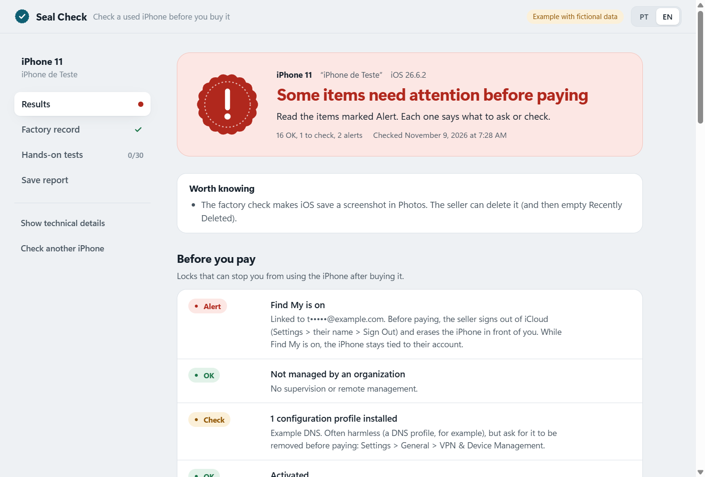

# Lacre (Seal Check)

**Check a used iPhone before you pay for it.** Lacre is a free, open-source desktop app for Windows
and macOS. You plug the phone into your computer with a USB cable and it tells you, in plain
language, whether the phone is locked to someone else, managed by a company, or has parts that
don't match what Apple recorded at the factory.

[Português (Brasil)](README.pt-BR.md)



## Download

Get the installer for your system from the
[Releases page](https://github.com/dosxnjos/lacre/releases):

- **Windows 10/11:** `.msi` or `.exe` installer. Also install Apple's free
  [Apple Devices](https://apps.microsoft.com/detail/9np83lwlpz9k) app from the Microsoft Store
  (it provides the USB connection to the iPhone). Lacre tells you if it is missing.
  The installer is not code-signed yet: if SmartScreen says "Windows protected your PC", click
  **More info → Run anyway**.
- **macOS (Apple silicon):** `.dmg`. Nothing else to install. The app is not notarized yet: the
  first time, right-click the app → **Open** → **Open**. Intel Macs: build from source.

## How to use it (5 steps)

1. **Connect** the iPhone with a cable that carries data (not a charge-only cable). On a desktop PC,
   use a port on the back.
2. **Unlock** the iPhone and tap **Trust**, then enter the phone's passcode. The seller has to do
   this if they won't hand you the code.
3. **Read** the phone: one click, about 40 seconds. You get a verdict first (green, yellow or red)
   and the details below it.
4. **Factory check** (optional, strongly recommended, 5 to 10 minutes): press both volume buttons
   and the side button together, briefly (under one second). The phone vibrates and takes a
   screenshot. Lacre waits, reads Apple's factory record and cleans up after itself. Tell the
   seller first: iOS leaves that screenshot in Photos.
5. **Test by hand** with the guided checklist (IMEI, microphones, speakers, cameras, Wi-Fi,
   Bluetooth, screen, True Tone, touch while charging from a wall outlet...), then **export** the
   report as HTML or TXT if you want to keep it.

Tip: bring your own wall charger. Some faulty screens only show "ghost touches" while plugged into
the mains, and a power bank can hide the problem. See [the touch test](docs/HOW-IT-WORKS.md#touch-test).

## What it checks

| Area | What Lacre looks at |
| --- | --- |
| **Purchase blockers** | Find My / Activation Lock flag, MDM and supervision (company-owned phones), installed configuration profiles, activation state, model-number prefix (new, Apple replacement, refurbished, engraved, demo) |
| **Apple's factory record** | The FDR report the phone keeps: which parts Apple sealed at the factory and whether the installed ones still match, plus the seal date |
| **Part dates** | Manufacturing dates read from part serial numbers (cameras, Face ID, display, battery) compared with the phone's assembly date |
| **Battery** | Official health percentage (from the factory check), cycle count, estimated capacity, battery age vs phone age |
| **Manual tests** | A guided checklist of things only a person can test, plus a touch test web page you open on the iPhone |

Everything is explained in [docs/HOW-IT-WORKS.md](docs/HOW-IT-WORKS.md). What Lacre cannot see is in
[docs/LIMITATIONS.md](docs/LIMITATIONS.md). Read that one before trusting a green verdict blindly.

## Privacy

- Runs **entirely on your computer**. No account, no server, no telemetry.
- **Read-only.** Lacre never writes to the iPhone: no profiles, no erase, no settings changed.
  The one exception is deleting the diagnostic archive that Lacre itself asked for.
- The factory check downloads a sysdiagnose archive (about 350 MB of the phone's logs) to a temporary
  folder. Lacre reads **only two files** from it (`logs/FDR/FDRDiagnosticReport.plist` and
  `logs/BatteryHealth/BatteryHealth.log`) and then deletes the archive from the computer **and** from
  the phone.
- iOS saves a screenshot in Photos when the sysdiagnose is triggered. Tell the seller, or delete it.
- Exported reports contain the serial number and IMEI. Keep them private.

## Requirements

| System | What you need |
| --- | --- |
| Windows 10/11 | Apple's free **Apple Devices** app (Microsoft Store), which runs the USB service. iTunes also works. |
| macOS | Nothing: the USB service is built in. |
| Linux | No installer yet; build from source and run `usbmuxd`. |

The iPhone needs to be unlocked and trusted. The factory check works on recent iOS versions,
including iOS 17.4 and later.

---

## For developers

### Architecture

```
Tauri shell (Rust + TypeScript UI)
   <-> JSON Lines over stdin/stdout
Python engine (pymobiledevice3, frozen with PyInstaller)
   <-> usbmux (Apple Devices / usbmuxd)
iPhone
```

The engine emits codes and parameters, never human text; the UI translates them (pt-BR and en).
The contract between the two is [docs/PROTOCOL.md](docs/PROTOCOL.md).

### Build from source

Prerequisites: [uv](https://docs.astral.sh/uv/) (Python 3.12), Node.js 22+, Rust stable, and the
[Tauri 2 prerequisites](https://v2.tauri.app/start/prerequisites/) for your OS.

```sh
# 1. Freeze the engine (pymobiledevice3==11.50.2) into engine/dist/lacre-engine/
uv run --project engine --with pyinstaller python engine/build.py

# 2. Build the app and installers (Tauri 2)
npm install
npm run build
```

Development mode, with the engine run from source:

```sh
npm install
npm run dev
```

Releases are built by GitHub Actions on Windows and macOS when a `v*` tag is pushed
([.github/workflows/build.yml](.github/workflows/build.yml)).

### Contributing

See [CONTRIBUTING.md](CONTRIBUTING.md). Never commit a real device read: they contain serials and
IMEIs.

## License and trademarks

[MIT](LICENSE) © 2026 Gabriel dos Anjos.

Lacre is not affiliated with, endorsed by or sponsored by Apple Inc. "iPhone" and "Apple" are
trademarks of Apple Inc., registered in the U.S. and other countries. Lacre uses the open-source
[pymobiledevice3](https://github.com/doronz88/pymobiledevice3) library.
