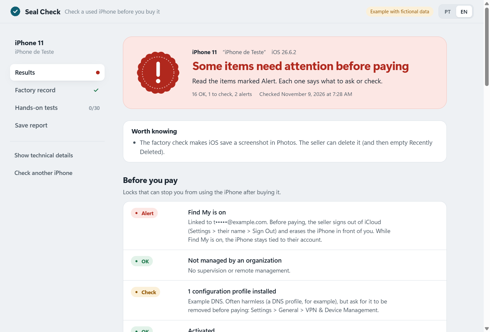

# Lacre

**Confira um iPhone usado antes de pagar por ele.** O Lacre é um app gratuito e de código aberto
para Windows e macOS. Você liga o celular no computador com um cabo USB e ele diz, em linguagem
simples, se o aparelho está preso à conta de outra pessoa, se é gerenciado por uma empresa ou se tem
peças que não batem com o que a Apple registrou na fábrica.

[English](README.md)



## Baixar

Baixe o instalador do seu sistema na
[página de Releases](https://github.com/dosxnjos/lacre/releases):

- **Windows 10/11:** instalador `.msi` ou `.exe`. Instale também o app gratuito
  [Apple Devices](https://apps.microsoft.com/detail/9np83lwlpz9k), da Microsoft Store (é ele que faz
  a conexão USB com o iPhone). O Lacre avisa se estiver faltando.
  O instalador ainda não tem assinatura digital: se o SmartScreen disser "O Windows protegeu o
  computador", clique em **Mais informações → Executar assim mesmo**.
- **macOS (Apple silicon):** `.dmg`. Não precisa de mais nada. O app ainda não é notarizado: na
  primeira vez, clique com o botão direito no app → **Abrir** → **Abrir**. Mac com Intel: compile a
  partir do código.

## Como usar (5 passos)

1. **Ligue** o iPhone com um cabo que passa dados (não um cabo só de carga). Em PC de mesa, use uma
   porta de trás.
2. **Desbloqueie** o iPhone e toque em **Confiar**; ele pede o código do aparelho. Se o vendedor
   não quiser passar o código, ele mesmo digita.
3. **Leia** o aparelho: um clique, uns 40 segundos. Primeiro vem o veredito (verde, amarelo ou
   vermelho) e, abaixo, os detalhes.
4. **Conferência de fábrica** (opcional, muito recomendada, 5 a 10 minutos): aperte juntos os dois
   botões de volume e o botão lateral, rapidinho (menos de 1 segundo). O iPhone vibra e tira um
   print. O Lacre espera, lê o registro de fábrica da Apple e apaga o que baixou. Avise o vendedor
   antes: o iOS deixa esse print nas Fotos.
5. **Teste na mão** com o roteiro guiado (IMEI, microfones, alto-falantes, câmeras, Wi-Fi,
   Bluetooth, tela, True Tone, toque com o aparelho carregando na tomada...) e, se quiser guardar,
   **exporte** o relatório em HTML ou TXT.

Dica: leve o seu carregador de tomada. Algumas telas com defeito só mostram "toque fantasma" quando
o aparelho está ligado na tomada, e um power bank pode esconder o problema. Veja
[o teste de toque](docs/HOW-IT-WORKS.md#touch-test).

## O que ele confere

| Área | O que o Lacre olha |
| --- | --- |
| **Travas de compra** | Buscar iPhone / Bloqueio de Ativação, MDM e supervisão (aparelho de empresa), perfis de configuração instalados, estado de ativação, prefixo do número do modelo (novo, reposição Apple, recondicionado, gravado, demonstração) |
| **Registro de fábrica da Apple** | O relatório FDR que o próprio iPhone guarda: quais peças a Apple selou na fábrica, se as instaladas ainda batem, e a data do selo |
| **Datas das peças** | Data de fabricação tirada do número de série das peças (câmeras, Face ID, tela, bateria) comparada com a data de montagem do aparelho |
| **Bateria** | Saúde oficial em % (pela conferência de fábrica), ciclos, capacidade estimada, idade da bateria × idade do aparelho |
| **Testes manuais** | Roteiro guiado do que só uma pessoa consegue testar, mais uma página de teste de toque para abrir no iPhone |

Os detalhes técnicos estão em [docs/HOW-IT-WORKS.md](docs/HOW-IT-WORKS.md) e o que o Lacre não
consegue ver está em [docs/LIMITATIONS.md](docs/LIMITATIONS.md) (em inglês). Leia os limites antes de
confiar cegamente num veredito verde.

## Privacidade

- Roda **inteiro no seu computador**. Sem conta, sem servidor, sem telemetria.
- **Somente leitura.** O Lacre nunca grava nada no iPhone: não instala perfil, não apaga, não muda
  ajuste. A única exceção é apagar o pacote de diagnóstico que o próprio Lacre pediu.
- A conferência de fábrica baixa um sysdiagnose (uns 350 MB de registros do aparelho) para uma pasta
  temporária. O Lacre lê **só dois arquivos** dele (`logs/FDR/FDRDiagnosticReport.plist` e
  `logs/BatteryHealth/BatteryHealth.log`) e depois apaga o pacote do computador **e** do iPhone.
  Nada fica para trás.
- O iOS salva um print nas Fotos quando o sysdiagnose é disparado. Avise o vendedor ou apague.
- O relatório exportado tem número de série e IMEI. Guarde só com você.

## Requisitos

| Sistema | O que precisa |
| --- | --- |
| Windows 10/11 | O app gratuito **Apple Devices** da Apple (Microsoft Store), que roda o serviço USB. O iTunes também serve. |
| macOS | Nada: o serviço USB já vem no sistema. |
| Linux | Ainda sem instalador; compile a partir do código e rode o `usbmuxd`. |

O iPhone precisa estar desbloqueado e com o computador marcado como confiável. A conferência de
fábrica funciona nos iOS recentes, inclusive do 17.4 em diante.

---

## Para desenvolvedores

### Arquitetura

```
Casco Tauri (Rust + interface TypeScript)
   <-> JSON Lines por stdin/stdout
Motor Python (pymobiledevice3, congelado com PyInstaller)
   <-> usbmux (Apple Devices / usbmuxd)
iPhone
```

O motor emite códigos e parâmetros, nunca texto para humanos; a interface traduz (pt-BR e en).
O contrato entre os dois é o [docs/PROTOCOL.md](docs/PROTOCOL.md).

### Compilar a partir do código

Pré-requisitos: [uv](https://docs.astral.sh/uv/) (Python 3.12), Node.js 22+, Rust estável e os
[pré-requisitos do Tauri 2](https://v2.tauri.app/start/prerequisites/) do seu sistema.

```sh
# 1. Congela o motor (pymobiledevice3==11.50.2) em engine/dist/lacre-engine/
uv run --project engine --with pyinstaller python engine/build.py

# 2. Compila o app e os instaladores (Tauri 2)
npm install
npm run build
```

Modo de desenvolvimento, com o motor rodando direto do código:

```sh
npm install
npm run dev
```

As versões publicadas são compiladas pelo GitHub Actions no Windows e no macOS quando uma tag `v*`
é enviada ([.github/workflows/build.yml](.github/workflows/build.yml)).

### Contribuir

Veja o [CONTRIBUTING.md](CONTRIBUTING.md) (em inglês). Nunca versione uma leitura real de aparelho:
ela tem serial e IMEI.

## Licença e marcas

[MIT](LICENSE) © 2026 Gabriel dos Anjos.

O Lacre não tem vínculo, aval nem patrocínio da Apple Inc. "iPhone" e "Apple" são marcas da Apple
Inc., registradas nos EUA e em outros países. O Lacre usa a biblioteca de código aberto
[pymobiledevice3](https://github.com/doronz88/pymobiledevice3).
